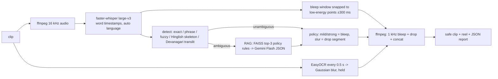
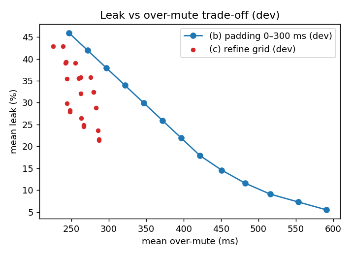

# SafeCut — context-aware profanity & slur censoring for sports highlights (English + Hinglish)

All numbers come from [`results/results.json`](results/results.json), produced by the Kaggle notebook (Tesla T4, Whisper large-v3).

## Pipeline

## Benchmark (synthetic, exact ground truth)
100 clean MELD test clips; half get one listed word (TTS) spliced at a pause with video frozen for the same time;
20 get offensive on-screen text, 10 get clean decoy text; 31 innocent sentences where a listed word is used innocently.
Thresholds tuned on a 30% dev split; numbers below are on the 70-clip test split (35 inserted words).

## Results
| Metric | Value |
|---|---|
| Detection precision (test) | 100.0% (95% CI 77.2–100.0) |
| Detection recall (test) | 37.1% (95% CI 23.2–53.7) |
| Recall with exact matching only | 25.7% (95% CI 14.2–42.1) |
| Final precision / recall, no context check | 100.0% (95% CI 77.2–100.0) / 37.1% (95% CI 23.2–53.7) |
| Final precision / recall, with context check | 100.0% (95% CI 64.6–100.0) / 20.0% (95% CI 10.0–35.9) |
| Innocent sentences censored, no context check | 93.5% (95% CI 79.3–98.2) |
| Innocent sentences censored, with context check | 19.4% (95% CI 9.2–36.3) |
| Rule cited is in retrieved top-3 | 86.5% |
| OCR blur recall, frames (forward hold) | 87.3% (95% CI 84.8–89.4) |
| Frames blurred without offensive text (forward) | 4.1% (95% CI 3.3–4.9) |
| OCR blur recall, frames (both hold) | 100.0% (95% CI 99.5–100.0) |
| Frames blurred without offensive text (both) | 9.5% (95% CI 8.4–10.8) |
| ASR speed | 3.9× real-time |
| End-to-end speed (incl. LLM calls) | 0.8× real-time |
| Whisper WER on untouched clips | 0.264 |

### Bleep boundaries (test, correctly detected words)
| Window | Mean leak | Words with any leak | Mean over-mute |
|---|---|---|---|
| (a) raw Whisper | 49.6% | 13/13 | 235 ms |
| (b) fixed pad 200 ms | 13.8% | 8/13 | 433 ms |
| (c) energy-snapped ±300 ms | 30.5% | 10/13 | 339 ms |

(c) − (b): leak +16.7 pts (95% CI +6.7 to +26.9),
over-mute -94 ms (95% CI -139 to -50).

## What I found
1. **The word list alone is unusable for broadcast.** It censored 93.5% of the 31 innocent sentences (rugby "hooker", "Lund University", Hindi "saala" = brother-in-law, ...). The RAG context check brought that down to 19.4%.
2. **That check is not free.** Recall after the decision fell from 37.1% to 20.0% (13 → 7 of 35 inserted words): the LLM also cleared some real insertions (hypothesis, not tested: a spliced word does not fit its sentence, so it looks accidental). This is the main trade-off to tune in a real system.
3. **ASR is the recall bottleneck, not matching.** Even before the context check, detection recall was 37.1%. Fuzzy + Hinglish spelling-variant matching raised it from 25.7% (exact only). Whisper wrote only 12 of the 50 inserted words exactly as the list spells them, so a better recogniser (or biasing it towards listed words) is the next lever.
4. **Raw Whisper word timestamps leak badly.** A bleep on the raw timestamps left 49.6% of the word audible on average (13/13 words leaked).
5. **My boundary-refinement hypothesis was wrong.** I expected energy snapping (c) to match padding's leak with less muting. It did mute less (339 vs 433 ms), but leaked more (30.5% vs 13.8%; difference +16.7 pts, 95% CI +6.7 to +26.9). My untested guess: some Whisper boundary errors are larger than the ±300 ms search window, which a fixed pad absorbs. On this data the fixed pad is the safer default.
   The dev-split trade-off plot adds nuance: every refine setting lies below and left of the padding curve, so at equal over-mute snapping leaks less than padding. But no refine setting got below roughly 20% leak on dev, while padding keeps lowering leak as you accept more muting. Next step: snap first, then add a small pad.

   
6. **Offline processing helps on-screen blur.** Holding each OCR result only forward (live-style) blurred 87.3% of offensive-text frames; also blurring back to the previous sample (possible because highlights are not live) reached 100.0%, at the cost of more frames blurred without offensive text (4.1% → 9.5%).
7. **Not real-time yet.** End to end 0.85× real-time on a Tesla T4 (437 s of audio): ASR 113 s, OCR 224 s (measured on the 30 text clips and scaled to 100), rendering 151 s, LLM 28 s. OCR and libx264 rendering dominate.

## How to run
1. Kaggle notebook [`safecut_kaggle.ipynb`](safecut_kaggle.ipynb): GPU T4 x2, Internet on, secret `GEMINI_API_KEY`, inputs `zaber666/meld-dataset` and a dataset with the two files in [`assets/`](assets). Every cell ends with `✅` assertions.
2. The notebook writes the [`safecut/`](safecut) package it evaluates. The Streamlit demo [`app.py`](app.py) reuses that package: `streamlit run app.py` after a notebook run (it reads `tiers.json` and `run_cfg.json` from `SAFECUT_PROJ`).

## Repository
| Path | What it is |
|---|---|
| `safecut/` | lexicon + matching, LLM judge (Gemini → local Qwen fallback, cached), policy RAG, ASR, boundary windows, synthetic benchmark builder, OCR blur, ffmpeg render, metrics |
| `assets/content_policy.md` | 15-rule broadcast policy used for retrieval |
| `assets/innocent_sentences.jsonl` | 31 innocent-usage test sentences (24 English, 7 Hinglish) |
| `results/results.json` | every metric in this README |
| `results/report.json` | per-event report: time, tier, action, rule cited (never the word itself) |

No offensive word is written in the code; words come from the pinned [LDNOOBW](https://github.com/LDNOOBW/List-of-Dirty-Naughty-Obscene-and-Otherwise-Bad-Words) lists and are masked in every printout.

## Limitations
- Synthetic benchmark: TTS voices differ from live crowd / commentator audio; the inserted word does not fit the sentence, and pauses around it make boundaries easier than real speech.
- Small n (confidence intervals are wide); one random seed.
- Tiers come from an LLM pass over the LDNOOBW lists (cached in `tiers.json`), not from human annotators.
- OCR is English-only (EasyOCR `en`); Devanagari on-screen text is not handled. OCR every 0.5 s can miss text that appears briefly.
- LLM calls in the final run: {'models/gemini-flash-lite-latest': 8, 'cache': 6} (`cache` = answers reused from earlier calls in the same session; all from Gemini Flash / Flash-Lite, no local fallback).
- The rendered clips used window (c), the energy-snapped one, chosen before the test result was known. On test it leaked more than the 200 ms pad, so a deployment should switch to (b).
- In some `keep` decisions the LLM cited a rule whose own text says to bleep (for example R11, non-graphic slang = mild = bleep). The decision and the cited rule can disagree.
