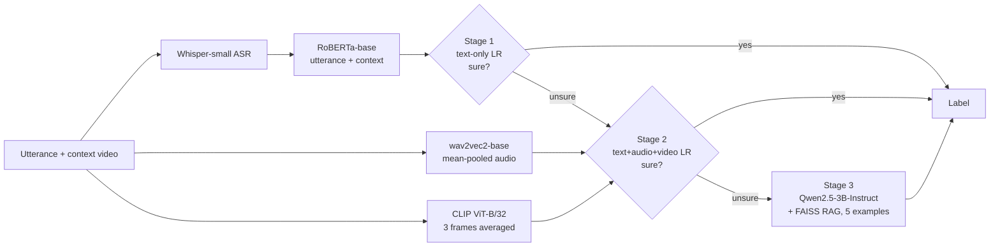
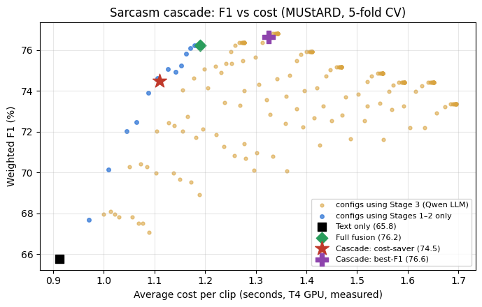

# Cost-Aware Multimodal Sarcasm Detection for TV Dialogue

Detect sarcasm in sitcom clips from **what is said (text), how it is said (audio) and how the speaker looks (video)**, and do it **cost-aware**: a cheap text model handles easy clips, and only uncertain clips are escalated to the full multimodal model and then to an LLM.

All numbers below come from cells run on a Kaggle notebook (2× Tesla T4, Python 3.13).

---

## Problem

Sarcasm often means the opposite of the literal words ("It's just a privilege to watch your mind at work."). Text alone misses tone of voice and facial expression. But running every model on every clip is expensive. So the question is:

> How much of the full multimodal accuracy can we keep while paying for the expensive stages only when the cheap model is unsure?

The pipeline is also kept **realistic**: it uses **Whisper speech-to-text transcripts instead of the dataset's gold transcripts**, because a live TV stream has no gold transcripts.

## Data

[MUStARD](https://github.com/soujanyaporia/MUStARD) (Castro et al., ACL 2019): **690 clips, balanced (345 sarcastic, 345 not)**.

| Show | Clips |
|---|---|
| Friends | 356 |
| The Big Bang Theory | 280 |
| The Golden Girls | 40 |
| Sarcasmoholics (dataset label) | 14 |

Each clip has an utterance video and a context video (the preceding dialogue). All 690 utterance and 690 context videos were downloaded (from the Hugging Face link in the repo README).

## Pipeline



| Step | Model | Output |
|---|---|---|
| Speech-to-text | `faster-whisper` small (fp16) | utterance + context transcripts |
| Text features | `roberta-base`, mean-pooled last layer | 1536-d (utterance 768 + context 768) |
| Audio features | `facebook/wav2vec2-base`, mean-pooled | 768-d |
| Video features | CLIP ViT-B/32 (OpenAI weights), frames at 25/50/75% | 512-d |
| Classifiers | Standardize → logistic regression (C tuned by inner 5-fold CV) | probability of sarcasm |
| Stage 3 | Qwen2.5-3B-Instruct, FAISS index of RoBERTa embeddings from training folds only, 5 retrieved labelled examples, JSON output `{label, confidence, main_cue, explanation}` | label + explanation |

All features are cached to `.npy` and every stage is timed per clip (batch size 1, `torch.cuda.synchronize()`).

## Results

### 1. Speech recognition (Whisper-small vs gold transcripts)

| | WER |
|---|---|
| Utterances (all 690) | **16.9%** |
| — Big Bang Theory | 10.6% |
| — Friends | 23.8% |
| — Golden Girls | 21.9% |
| — Sarcasmoholics (14 clips) | 53.0% |
| Context clips | 23.6% |

0 empty transcripts. Part of the WER is spelling, not hearing (e.g. "gotta" vs "got to").

### 2. Modality comparison (5-fold stratified CV, weighted F1)

Text input = Whisper transcripts (not gold).

| Model | Dims | Weighted F1 (mean ± std over folds) | Accuracy | Paper baseline* |
|---|---|---|---|---|
| Text | 1536 | **65.8 ± 3.6** | 65.8 | 64.6 |
| Text + Audio | 2304 | **68.2 ± 5.4** | 68.4 | — |
| Text + Video | 2048 | **74.4 ± 4.5** | 74.5 | 71.6 |
| Text + Audio + Video | 2816 | **76.2 ± 4.8** | 76.2 | — |

\*Castro et al. 2019, SVM, speaker-dependent setup, **gold transcripts**. Our random stratified split is also speaker-dependent (the same characters appear in train and test). Our features are different (RoBERTa/wav2vec2/CLIP), so this is a reference point, not a controlled comparison.

Every added modality helps, and all three together give **+10.4 F1 over text only**, even with ~17% ASR errors in the text.

### 3. Measured cost per clip (T4 GPU, batch size 1)

| Component | Mean time |
|---|---|
| Whisper, utterance | 0.245 s |
| Whisper, context | 0.651 s |
| RoBERTa | 16.9 ms |
| **Stage 1 total** | **0.913 s** |
| wav2vec2 | 33.8 ms |
| CLIP (decode 3 frames + encode) | 242.7 ms |
| **Stage 2 extra** | **0.277 s** |
| **Stage 3 extra** (Qwen2.5-3B, ~678 tokens in / 53 out) | **2.929 s** |

**Whisper is 0.896 s of the 1.190 s full-fusion cost (≈75%).** Every clip pays for it, so a cascade can save at most the Stage 2 share (≈23%).

### 4. Stage 3 LLM on the 120 hardest clips

The 120 clips where the full fusion model is least certain (probability closest to 0.5):

| Model | Weighted F1 | Accuracy |
|---|---|---|
| Qwen2.5-3B RAG (text only) | 35.8 | 45.8 |
| Full fusion model | 62.5 | 62.5 |

Qwen predicted "sarcastic" for **90%** of these clips (true rate 47%). 0 JSON parse failures. It gave `main_cue: "tone"` 112 times out of 120 even though it never received audio, so **its cue labels and explanations are not grounded** and should not be trusted.

### 5. Cascade: F1 vs cost



Thresholds are swept on all clips for the plot. For the reported numbers, thresholds are **chosen on 4 folds and tested on the held-out 5th** (repeated for all 5 folds), so they are not tuned on the clips they are scored on.

| Setup | Weighted F1 | Cost / clip | % of full-fusion F1 | % of full-fusion cost | Reach Stage 2 | Reach Stage 3 | McNemar vs full fusion |
|---|---|---|---|---|---|---|---|
| Text only | 65.8 | 0.913 s | — | — | 0% | 0% | — |
| Full fusion | 76.2 | 1.190 s | 100% | 100% | 100% | 0% | — |
| **Cascade: cost-saver** (cheapest config keeping ≥98% F1 on selection folds) | **74.5** | **1.110 s** | **97.7%** | **93.3%** | 70.1% | 0.0% | p = 0.036 (8 vs 20 discordant) |
| **Cascade: best-F1** (highest F1 on selection folds) | **76.6** | **1.325 s** | **100.5%** | **111.4%** | 94.5% | 5.2% | p = 0.678 (13 vs 10 discordant) |

What this shows:

- **Cost-saver** keeps 97.7% of full-fusion F1 for 6.7% less compute, but the drop is **statistically significant** (McNemar p = 0.036). The saving is small because ASR dominates the cost.
- **Best-F1** sends 5.2% of clips to the LLM and is +0.4 F1 over full fusion, which is **not significant** (p = 0.678), at 11.4% more cost. The LLM only helps on near coin-flip clips and is worse than the fusion model on the hard set overall.
- The real cost lever is **speech recognition**, not fusion: a cheaper ASR model or skipping context transcription would save more than any threshold choice.

### Gemini attempt (not used)

Stage 3 was first built with Gemini Flash (free tier) on the same RAG prompt, with the video attached. It was dropped because of free-tier limits: repeated `503 UNAVAILABLE` on the newest Flash model, single calls taking 200+ s under load, and then `429` quota errors on every Flash model before a meaningful number of clips finished. Only 2 clips completed, so no Gemini results are reported. A speed test before the quota ran out measured 5.9 s per call (3.5 Flash with video) and 3.5 s (3.6 Flash, text only). Moving to a self-hosted LLM made Stage 3 cost predictable and free of rate limits.

## Limitations

- **Small dataset**: 690 clips; fold-to-fold std is 3.6–5.4 F1, so neighbouring rows in the modality table are not clearly separated.
- **Sitcom domain only**: 4 shows, 92% from Friends and Big Bang Theory. Not tested on other TV genres, live broadcasts or other languages.
- **Speaker-dependent split**: the same characters appear in train and test. CLIP features may partly recognize *who* is speaking (some characters are sarcastic far more often), which can inflate video gains.
- **LLM stage**: Qwen2.5-3B is text-only, strongly biased toward "sarcastic", and its `main_cue`/explanations are not grounded in audio or video. It was run on the 120 hardest clips only, so its standalone score is not comparable to the full-dataset scores.
- **ASR errors** (16.9% utterance WER, 23.6% context WER, 53.0% on Sarcasmoholics) flow into the text features.
- **Costs** are wall-clock seconds on a Kaggle T4 at batch size 1; they would differ on other hardware or with batching. Logistic-regression inference time is negligible and not counted.
- One CV split (seed 42); no repeated-seed confidence intervals.

## Demo app (Streamlit)

`app/` runs the cascade on one clip, locally on CPU: upload an utterance clip (and optionally its context clip), and it shows the Whisper transcript, each stage's probability and time, which stage decided, the label, and an LLM explanation.

1. Run Cell 10 in the notebook, then download `app_bundle.npz` and `app_meta.json` into `app/`.
2. Install and run:

```bash
cd app && python3 -m venv .venv && .venv/bin/pip install -r requirements.txt
.venv/bin/streamlit run app.py
```

The first run downloads the models (~2 GB). Thresholds come from the notebook (cost-saver or best-F1, median over folds), or set them by hand. **In the app, Stage 3 is Gemini** (paste a free API key in the sidebar), because Qwen2.5-3B is too heavy for a laptop CPU. The evaluation numbers above used Qwen for Stage 3. If Gemini is unavailable, the app falls back to the Stage 2 label and says so.

## Reproduce

Kaggle notebook (GPU T4 ×2, internet on), cells in order:

1. Setup + labels → 2. Download videos → 3. Whisper ASR + WER → 4. Context ASR + RoBERTa → 5. wav2vec2 audio → 5b. CLIP video → 6. 5-fold CV models → 7a. FAISS index + RAG prompt → 8 / 8b. Qwen2.5-3B Stage 3 → 9. Cascade sweep, plot, McNemar → 10. Export models for the app.

Outputs in `/kaggle/working/sarcasm_cascade/`: `results_table.csv`, `cascade_sweep.csv`, `cascade_per_clip.csv`, `cascade_thresholds.json`, `cascade_plot.png`, and cached features in `cache/`.

## Reference

Castro, S., Hazarika, D., Pérez-Rosas, V., Zimmermann, R., Mihalcea, R., & Poria, S. (2019). *Towards Multimodal Sarcasm Detection (An Obviously Perfect Paper).* ACL 2019.
