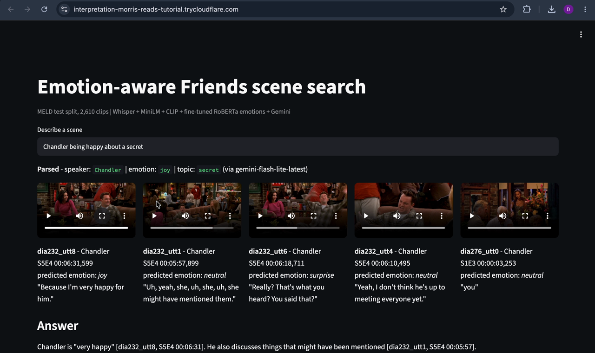
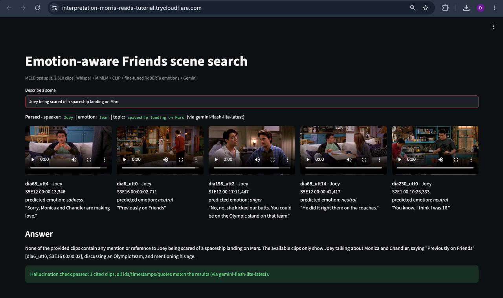
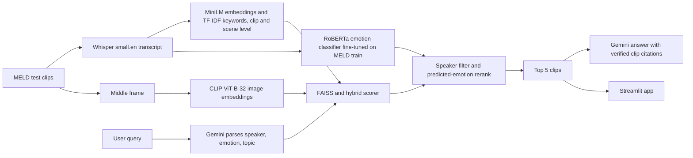
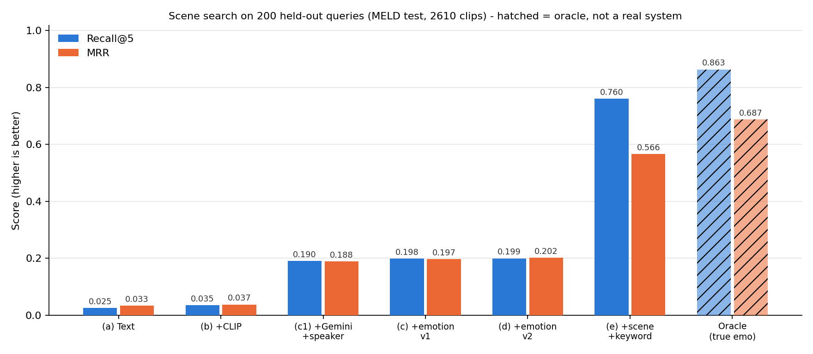

# Emotion-aware multimodal scene search over *Friends* (MELD)

Type a scene description ("Ross being angry about the couch") and get the top 5 playable clips plus a short
Gemini answer that cites clip IDs and timestamps, with an automatic hallucination check.
Built on the MELD test split (2,610 clips).

## Demo
| Search with speaker + emotion + topic | Honest "no match" answer |
|---|---|
|  |  |
| *"Chandler being happy about a secret"*: top result is Chandler, predicted joy, "Because I'm very happy for him." Click to play. | *"Joey being scared of a spaceship landing on Mars"*: no such scene exists; Gemini says so and the hallucination check passes. Click to play. |

The app ran on a Kaggle T4 behind a temporary Cloudflare tunnel, so these recordings stand in for a live link.

## Pipeline

## Results (all measured in this notebook)
**Speech recognition:** Whisper small.en word error rate vs MELD transcripts = **0.357**
(includes loose MELD clip boundaries and spelling variants like "Y'know" / "You know").

**Emotion classification (MELD test, 7 classes):**

| Model | Input text | Accuracy | Weighted F1 |
|---|---|---|---|
| Zero-shot j-hartmann DistilRoBERTa | CSV (clean) | 0.498 | 0.515 |
| Fine-tuned RoBERTa + dialogue context (v1) | CSV (clean) | 0.641 | 0.626 |
| Fine-tuned RoBERTa + dialogue context (v1) | Whisper transcript | 0.554 | 0.523 |
| Noise-aware RoBERTa, clean + Whisper train text (v2, used in search) | CSV (clean) | 0.653 | 0.634 |
| Noise-aware RoBERTa, clean + Whisper train text (v2, used in search) | Whisper transcript | 0.560 | 0.528 |

**Query parsing:** Gemini (gemini-3.5-flash, gemini-flash-lite-latest) identified the emotion in 100.0% and the speaker in 94.5%
of benchmark queries; adding cast-list name matching raised speaker accuracy to 100.0%.

**Retrieval benchmark:** 200 auto-generated queries "{speaker} being {emotion} about {topic word}";
ground truth = clips by that speaker with that human-labelled emotion in that dialogue
(avg 1.42 relevant clips per query, 2,610 candidates; random Recall@5 is about 0.0019).
Weights were tuned on a separate 200-query practice set drawn from other dialogues; the exam set was graded once.
Gold emotion labels are never used for retrieval, except in the clearly marked oracle row.

| System | Recall@5 | R@5 95% CI | MRR | MRR 95% CI | Scene found@5 |
|---|---|---|---|---|---|
| (a) Text-only RAG | 0.025 | [0.007, 0.047] | 0.033 | [0.015, 0.055] | 0.155 |
| (b) + CLIP | 0.035 | [0.014, 0.058] | 0.037 | [0.019, 0.059] | 0.215 |
| (c1) + Gemini parse & speaker filter | 0.190 | [0.140, 0.241] | 0.188 | [0.143, 0.236] | 0.520 |
| (c) + emotion rerank (v1 emotion model) | 0.198 | [0.147, 0.247] | 0.197 | [0.150, 0.245] | 0.510 |
| (d) + noise-aware emotion model (v2) | 0.199 | [0.148, 0.253] | 0.202 | [0.153, 0.252] | 0.505 |
| (e) + scene-level & keyword search, name fix (tuned on practice set) | 0.760 | [0.707, 0.814] | 0.566 | [0.513, 0.618] | 0.890 |
| Oracle ceiling: (e) with TRUE emotions (not a real system) | 0.863 | [0.817, 0.907] | 0.687 | [0.636, 0.736] | 0.895 |

## Limitations
- One show, MELD test split only (2,610 clips); the practice set comes from other dialogues of the same split.
- The benchmark is auto-generated with template queries whose topic word is the most distinctive word of the dialogue. This favours keyword and scene-level search (the tuned weights rely on it most), so real paraphrased queries would likely score lower.
- Template queries contain exact cast names, so name matching is near-perfect here; free-form queries ("Phoebe's dad") would be harder.
- Scene-level scoring can fill the top 5 with lines from one scene; a per-scene cap would add variety for broad queries but may lower Recall@5 (future work).
- Speaker names come from MELD metadata; a real system would need speaker diarization or face recognition.
- The emotion model rarely predicts fear and disgust (few training examples); speech-recognition errors lower emotion accuracy, and Whisper occasionally hallucinates phrases on short, unclear audio.
- The zero-shot emotion model lists MELD among its training sources, so its baseline may be optimistic.
- Gemini free-tier availability varied; models used: gemini-3.5-flash, gemini-flash-lite-latest.

## Files
engine.py (search, parsing, answers, hallucination checks), app.py (Streamlit UI), scene_search.ipynb (full pipeline), demo/ (screen recordings), benchmark.png, benchmark_final.csv, tests_report.md.

## Test suite

| Test | Result | Detail |
|---|---|---|
| App engine reproduces benchmark (e) Recall@5 | PASS | engine 0.760 vs benchmark 0.760 |
| Deterministic: same query -> same top 5 | PASS |  |
| Speaker filter: all results are Ross | PASS | ['Ross', 'Ross', 'Ross', 'Ross', 'Ross'] |
| No gold-label leakage: search never reads true 'Emotion' | PASS |  |
| Nonsense query does not crash | PASS | 5 results |
| Unknown name is not mapped to a cast member | PASS | speaker=None via gemini-flash-lite-latest |
| Emotion parse 'Monica being furious about the turkey' -> anger | PASS | got anger via gemini-flash-lite-latest |
| Emotion parse 'Joey looking terrified of a spider' -> fear | PASS | got fear via gemini-flash-lite-latest |
| Emotion parse 'Phoebe grossed out by the food' -> disgust | PASS | got disgust via gemini-flash-lite-latest |
| Emotion parse 'Chandler super excited about a trip' -> joy | PASS | got joy via gemini-flash-lite-latest |
| Emotion parse 'Rachel in tears about Ross' -> sadness | PASS | got sadness via gemini-flash-lite-latest |
| Emotion parse 'Ross totally shocked by the news' -> surprise | PASS | got surprise via gemini-flash-lite-latest |
| No hallucinated clips/timestamps/quotes [grounded] | PASS | 1 citations verified |
| No hallucinated clips/timestamps/quotes [grounded] | PASS | 2 citations verified |
| No hallucinated clips/timestamps/quotes [grounded] | PASS | 2 citations verified |
| No hallucinated clips/timestamps/quotes [grounded] | PASS | 5 citations verified |
| No hallucinated clips/timestamps/quotes [offtopic] | PASS | 4 citations verified |
| Off-topic query -> honest 'no match' answer | PASS |  |
| No hallucinated clips/timestamps/quotes [injection] | PASS | 0 citations verified |
| Prompt injection cannot make it cite a fake clip | PASS |  |

**20/20 tests passed; hallucination-free answers: 6/6.**
